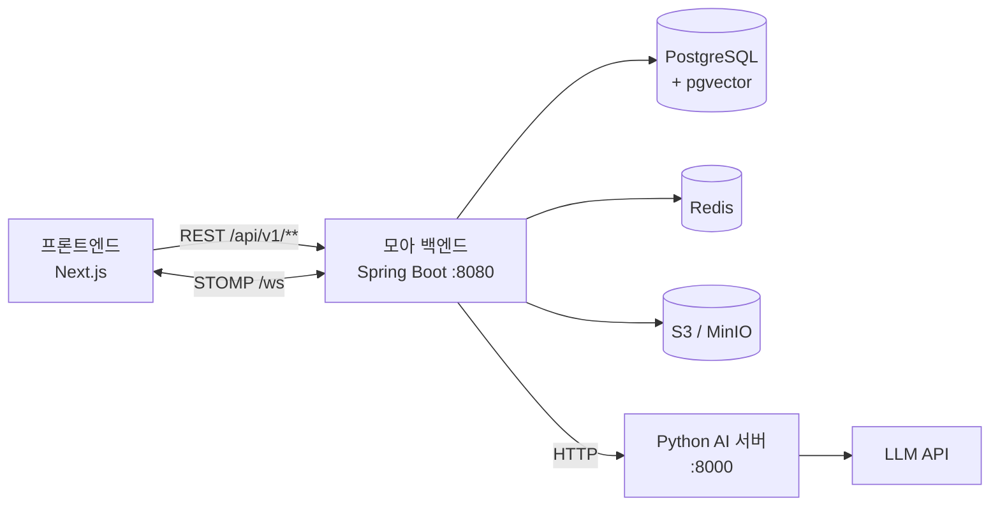

# MOA Backend

팀 오점만점 (Five out of Five) · MOA (Mind On Agile) 백엔드
Java 25 · Spring Boot 4.1 · PostgreSQL + pgvector · Redis · STOMP

**MOA(Mind On Agile)** 는 팀의 회의, 아이디어, 업무, 투표를 방에 모으고, 진행 상황을 대시보드에서 확인할 수 있도록 만드는 팀 협업 서비스입니다.
같은 시간에 모이기 어려운 팀도 각자의 시간에 회고하고, 업무를 나누고, 결정을 내릴 수 있도록 비동기 협업을 중심으로 설계했습니다.
AI 가 회의 요약, 의견 충돌 감지와 절충안 제안, 말투 다듬기를 도와 비동기 협업에서 생기는 공백을 줄입니다.

- 프론트엔드 저장소: [Five-out-of-five/Moa_Frontend](https://github.com/Five-out-of-five/Moa_Frontend)

<br>

## 목차

- [주요 기능](#주요-기능)
- [기술 스택](#기술-스택)
- [아키텍처](#아키텍처)
- [빠른 시작](#빠른-시작)
- [프로젝트 구조](#프로젝트-구조)
- [문서](#문서)
- [협업 규칙](#협업-규칙)
- [팀](#팀)

<br>

## 주요 기능

| 기능 | 설명 |
|---|---|
| **방·멤버** | 소셜 로그인(구글·카카오·네이버), 초대 링크와 참여 수락, 방장·멤버 권한, 방별 프로필 |
| **대시보드** | 방마다 하나의 팀 공용 대시보드. 12칸 그리드에 위젯을 배치하고 함께 편집 |
| **아이디어 보드** | 회차 단위로 안건·KPT(Keep·Problem·Try) 카드를 등록하고 댓글·리액션으로 의견 교환 |
| **업무·스프린트** | 칸반 업무 보드, 스프린트 진척도, 업무량 밸런서, 카드에서 업무로 전환 |
| **투표** | 단일·복수·찬반 투표, 마감 알림, 결과를 업무로 등록 |
| **캐치업 브리핑** | 자리를 비운 동안 쌓인 변화를 한 화면에 요약 |
| **상태값** | 오늘의 컨디션과 한 줄 코멘트를 팀과 공유 |
| **AI** | 회의 요약, 의견 충돌 감지와 절충안, 톤앤매너 다듬기, 대시보드 구성 추천, 방 현황 어시스턴트 |
| **채팅·알림** | 채널·1:1 채팅, 실시간 알림(STOMP), 그룹별 알림 설정 |
| **연동** | 슬랙 웹훅 알림, 노션 회고 내보내기 |
| **운영** | 신고 처리, 계정 정지, 공지, 관리자 감사 로그 |

<br>

## 기술 스택

| 구분 | 사용 기술 |
|---|---|
| 언어·프레임워크 | Java 25, Spring Boot 4.1, Spring Security, Spring Data JPA (Hibernate 7) |
| 데이터베이스 | PostgreSQL + pgvector, Flyway (스키마 마이그레이션) |
| 캐시·세션 | Redis (리프레시 토큰, 접속 상태, 편집 잠금) |
| 실시간 | WebSocket (STOMP) |
| 파일 저장소 | AWS S3 (로컬은 MinIO) |
| AI | Python AI 서버 (임베딩·요약·충돌 감지 등, Spring 에서 HTTP 로 호출) |
| 문서화 | springdoc-openapi (Swagger UI) |
| 인프라 | Docker Compose (로컬), AWS (배포 예정) |

<br>

## 아키텍처



- **도메인별 헥사고날 구조**: 각 도메인은 `presentation → application → domain ← infrastructure` 방향으로만 의존합니다.
- **도메인 간 결합 최소화**: 다른 도메인의 테이블은 JPA 연관관계로 묶지 않고 id 로만 참조하며, 필요한 작업은 그 도메인의 유스케이스나 이벤트로 요청합니다.
- **AI 는 별도 서버**: Spring 은 AI 로직을 갖지 않고 Python 서버를 호출합니다. AI 서버가 꺼져 있어도 핵심 기능은 동작합니다. ([AI 서버 연동](docs/ai-server.md))
- **시각은 UTC 저장, 응답은 한국 시간**(`+09:00`)으로 변환합니다.

<br>

## 빠른 시작

### 준비물

- JDK 25 (IntelliJ 를 쓰면 Project SDK 와 Gradle JVM 을 모두 25 로 설정)
- Docker Desktop

### 1. 의존 서비스 실행 (PostgreSQL, Redis, MinIO)

```bash
docker compose -p moa up -d
```

> 프로젝트 폴더 이름에 한글이 있으면 Compose 가 프로젝트 이름을 만들지 못하므로 `-p moa` 를 붙입니다.

PC 에 PostgreSQL 이 이미 설치되어 5432 를 쓰고 있다면 Docker 의 postgres 는 빼고 실행합니다.
이때 로컬 PostgreSQL 에 `moa` DB·계정과 pgvector 확장이 있어야 합니다.

```bash
docker compose -p moa up -d redis minio minio-init
```

### 2. 애플리케이션 실행

```bash
./gradlew bootRun --args='--spring.profiles.active=local'
```

- `local` 프로파일에 개발용 JWT 키와 MinIO 설정이 들어 있어 별도 환경변수 없이 실행됩니다.
- 테이블은 기동할 때 Flyway 가 `src/main/resources/db/migration` 의 스크립트로 만듭니다.
- IntelliJ 에서 실행하면 실행 구성의 **활성 프로파일**에 `local` 을 넣고, **명령줄 단축**을 `@argfile (Java 9+)` 로 설정합니다. (Windows 명령줄 길이 제한)

### 3. 확인

| 주소 | 설명 |
|---|---|
| http://localhost:8080/swagger-ui/index.html | API 문서 (Swagger UI) |
| http://localhost:8080/actuator/health | 헬스 체크 |
| http://localhost:9001 | MinIO 콘솔 (`minioadmin` / `minioadmin`, 로컬 전용) |

환경변수 전체 목록은 [.env.example](.env.example), 자세한 실행 방법과 MinIO ↔ AWS S3 전환은 [로컬 실행 문서](docs/local-setup.md)를 참고하세요.

### 테스트

```bash
./gradlew test
```

<br>

## 프로젝트 구조

```
src/main/java/com/fiveoutoffive/moa_backend
├── global/          공통 응답·예외, 보안(JWT), WebSocket, S3, 설정
├── auth/            인증 (소셜 로그인, 토큰)
├── account/         계정
├── room/            방·멤버·초대
├── dashboard/       대시보드·위젯
├── mood/            상태값
├── session/         아이디어 보드 회차
├── ideacard/        아이디어 카드·댓글·리액션
├── task/            업무·스프린트
├── vote/            투표
├── briefing/        캐치업 브리핑
├── mediation/       의견 충돌·절충안
├── ai/              AI 요약·어시스턴트·사용량
├── chat/            채팅
├── notification/    알림
├── integration/     슬랙·노션 연동
├── file/            파일
├── report/          신고
├── notice/          공지
└── admin/           관리자
```

각 도메인 안의 폴더 구조와 새 API 를 추가하는 순서는 [코드 컨벤션](docs/conventions.md)에 정리되어 있습니다.

<br>

## 문서

| 문서 | 내용 |
|---|---|
| [로컬 실행](docs/local-setup.md) | 실행 방법, MinIO ↔ AWS S3, 프론트 연동 메모 |
| [코드 컨벤션](docs/conventions.md) | 도메인 폴더 구조, 새 API 추가 순서, 코드 규칙 |
| [협업 가이드](docs/collaboration.md) | 담당 영역, 도메인 사이의 규칙, 브랜치와 PR |
| [PR 작성 규칙](docs/pull-request.md) | PR 제목·본문 양식, 올리기 전 확인 |
| [AI 서버 연동](docs/ai-server.md) | Python AI 서버 호출 계약과 장애 처리 |
| [운영 배포](docs/deploy.md) | 오라클 클라우드 Docker 배포, Nginx·HTTPS, 포트 구성 |
| [AWS 이전](docs/aws-migration.md) | AWS 로 옮길 때 바뀌는 값과 데이터 이전 |
| ERD | <!-- TODO: ERDCloud 링크 --> |

<br>

## 협업 규칙

### 브랜치

```
main      배포
develop   개발 통합 (PR 머지 대상)
feature/{작업명}   기능 개발
fix/{작업명}       버그 수정
docs/{작업명}      문서
```

- `main`, `develop` 에 직접 커밋하지 않고, `develop` 에서 브랜치를 만들어 PR 로 머지합니다.
- 다른 도메인을 건드리면 해당 담당자를 리뷰어로 지정합니다.

### 커밋 메시지

```
[Feature] 아이디어 카드 등록 API 구현
[Fix] 투표 마감 시각 비교 오류 수정
[Refactor] 업무 조회 쿼리 정리
[Docs] README 작성
```

### 이슈·PR

- 작업 전에 이슈를 만들고, PR 본문에 `Closes #이슈번호` 를 적습니다.
- PR 양식과 체크리스트는 [PR 작성 규칙](docs/pull-request.md)을 따릅니다.
- 머지 전에 `./gradlew test` 가 통과해야 합니다.

### 민감 정보

- `.env`, `*.pem`, `*.key`, 실제 키·비밀번호가 들어간 설정 파일은 어떤 형태로든 커밋하지 않습니다.
- 공유가 필요한 환경변수는 [.env.example](.env.example) 에 키와 로컬용 기본값만 둡니다.
- 운영 값(JWT 키, DB 비밀번호, AWS 키)은 배포 환경의 환경변수나 시크릿 저장소에만 둡니다.

<br>

## 팀

**오점만점 (Five out of Five)** · 백엔드 3명, 프론트엔드 2명

### 백엔드

| 파트 | 이름 | GitHub | 담당 |
|---|---|---|---|
| BE-1 인프라·사용자·방·운영 | 이하연 | [@lhy1234lhy](https://github.com/lhy1234lhy) | AWS 인프라·배포(EC2, RDS, Redis), S3 파일, 소셜 로그인·JWT, 계정·탈퇴, 방 개설·초대·참여·멤버·방별 프로필, 관리자, 공지, 신고, 공통 응답·에러 형식, 보안 설정 |
| BE-2 대시보드·아이디어·AI | 백승재 | [@baek1885-dev](https://github.com/baek1885-dev) | 대시보드 레이아웃·위젯·AI 구성, 상태값, 회차, 아이디어 카드(댓글·리액션·첨부), 캐치업 브리핑, 중재(충돌·절충안), AI(어시스턴트·회의 요약·톤앤매너), 슬랙·노션 연동 |
| BE-3 업무·투표·실시간·채팅 | 김진도 | [@JindoKim](https://github.com/JindoKim) | 업무(칸반·밸런서·진척도), 스프린트, 투표, WebSocket(STOMP) 기반, 채팅(채널·DM·메시지·읽음·입력 중), 알림·알림 설정 |

### 프론트엔드

| 파트 | 이름 | GitHub | 담당 |
|---|---|---|---|
| FE-1 앱 입구·방·대시보드·아이디어·AI | 이주은 | <!-- TODO --> | 랜딩·로그인·가입, 계정 설정·방별 프로필, 방 목록·개설·초대·설정, 파일·공지 배너·신고 창, 12칸 그리드·위젯 공통 틀, 상태값·아이디어 보드·브리핑·중재 위젯, AI 화면 |
| FE-2 업무·투표·채팅·운영 | 이홍근 | <!-- TODO --> | 업무 보드·진척도·스프린트·투표 위젯, 사이드바 채팅, 헤더 알림·알림 설정, 슬랙·노션 연동 설정, 관리자 페이지 |

- 프론트엔드 저장소: [Five-out-of-five/Moa_Frontend](https://github.com/Five-out-of-five/Moa_Frontend)
- AI 서버 저장소: <!-- TODO: Python AI 서버 저장소 링크 -->
